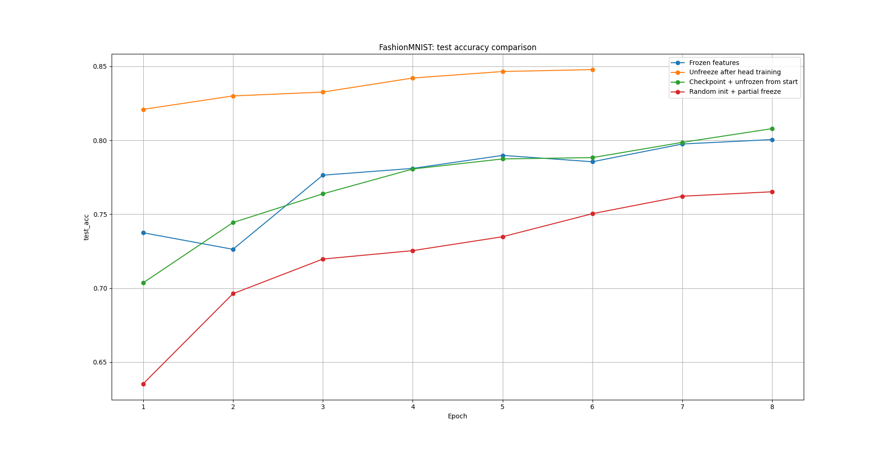
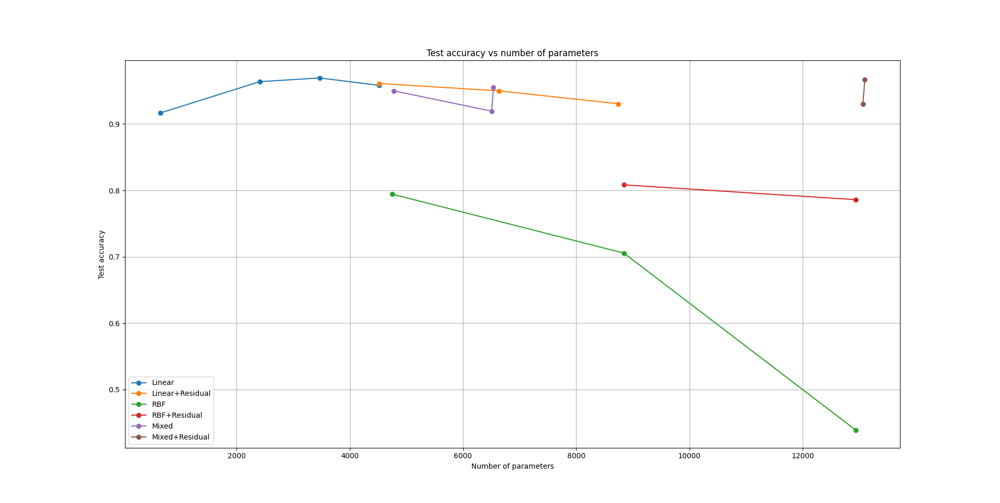

# ML Projects

Учебные проекты по машинному и глубокому обучению, выполненные во время обучения в **Университете ИТМО**. В репозитории собраны эксперименты с классификацией изображений и аудио, генеративными моделями и реализацией нейронных сетей с нуля.

**Стек:** Python · PyTorch · NumPy · scikit-learn · torchvision · Hugging Face Transformers · Matplotlib

## Проекты

| Направление | Описание |
| --- | --- |
| [Классификация изображений](./img-Jokersaw-main/) | CNN на MNIST и FashionMNIST, transfer learning, заморозка и дообучение слоёв |
| [Генеративные модели](./gen-Jokersaw-main/) | Свёрточный автоэнкодер, conditional GAN, Gaussian sampling и SMOTE |
| [Нейронные сети с нуля](./dl-Jokersaw-main/) | Backpropagation и Adam на NumPy, сравнение Linear, RBF и residual-архитектур |
| [Классификация аудио](./audio-Jokersaw-main/) | MFCC, Audio Spectrogram Transformer, fine-tuning и классические классификаторы |

## Классификация изображений

**Данные:** MNIST и FashionMNIST · **Инструменты:** PyTorch, torchvision

Реализовал свёрточную сеть с общим блоком извлечения признаков и отдельными классификационными головами. После обучения на MNIST исследовал перенос признаков на FashionMNIST: обучение новой головы при замороженном backbone и последующее размораживание свёрточной части. Сравнил результаты с другими стратегиями обучения.

| Эксперимент | Test accuracy |
| --- | ---: |
| CNN на MNIST | **98,35%** |
| FashionMNIST, замороженный backbone | **80,05%** |
| FashionMNIST, после разморозки backbone | **84,78%** |



[Исходный код](./img-Jokersaw-main/main.py) · [Графики и логи](./img-Jokersaw-main/results2/)

## Генеративные модели

**Данные:** FashionMNIST · **Инструменты:** PyTorch, NumPy

Реализовал и исследовал несколько способов генерации изображений:

- **Свёрточный автоэнкодер** с 32-мерным латентным пространством — обучение и реконструкция изображений.
- **Gaussian sampling и SMOTE** — получение новых примеров в пространстве пикселей и в латентном пространстве автоэнкодера.
- **Conditional GAN** — генерация изображений заданных классов и эксперимент со смешиванием классов.


[Исходный код](./gen-Jokersaw-main/main.py) · [Архитектуры моделей](./gen-Jokersaw-main/models.py) · [Результаты](./gen-Jokersaw-main/results/)

## Нейронные сети с нуля

**Данные:** sklearn Digits · **Инструменты:** NumPy, scikit-learn, Matplotlib

Реализовал компоненты нейронных сетей **без применения фреймворков автоматического дифференцирования**: полносвязные и RBF-слои, активации, прямой и обратный проходы, cross-entropy, оптимизатор Adam и residual-соединения.

Сравнил линейные, RBF, смешанные и residual-архитектуры на классификации рукописных цифр; проанализировал точность, количество параметров и кривые обучения. В одном из сохранённых экспериментов трёхслойная линейная сеть с ReLU достигла **96,9% test accuracy**.



[Реализация слоёв и обучения](./dl-Jokersaw-main/realization.py) · [Сравнение архитектур](./dl-Jokersaw-main/analysis_and_graphics.py) · [Логи](./dl-Jokersaw-main/results2/output.txt)

## Классификация аудио

**Данные:** [capa2000/binary-classifier-birdnet](https://huggingface.co/datasets/capa2000/binary-classifier-birdnet), записи двух видов птиц · **Инструменты:** librosa, PyTorch, Transformers, scikit-learn

Сравнил два представления аудио: классические **MFCC-признаки** и эмбеддинги предобученного **Audio Spectrogram Transformer (AST)**. Обучил Logistic Regression, SVM, Random Forest и KNN на извлечённых признаках. Также сравнил обучение классификационной головы при замороженном AST с fine-tuning всей модели; использовал PCA для визуализации признаков.

| Подход | Test accuracy |
| --- | ---: |
| MFCC + Random Forest | **97,50%** |
| AST-признаки + Logistic Regression | **98,75%** |
| Замороженный AST + обучаемая голова | **97,50%** |
| Fine-tuned AST + голова | **98,75%** |

*Результаты получены на тестовой выборке из 80 записей и отражают конкретный учебный эксперимент.*


[Исходный код](./audio-Jokersaw-main/main.py) · [Модели](./audio-Jokersaw-main/models.py) · [Подробные метрики](./audio-Jokersaw-main/results/important_output.md)

## Запуск

Каждый проект независим; скрипты нужно запускать из его папки.

```bash
git clone https://github.com/Jokersaw/ML-projects.git
cd ML-projects
python -m venv .venv
```

Активация окружения:

- **Windows:** `.venv\Scripts\activate`
- **Linux/macOS:** `source .venv/bin/activate`

Установка основных зависимостей:

```bash
python -m pip install torch torchvision numpy scipy scikit-learn matplotlib pandas librosa soundfile datasets transformers
```

Пример запуска генеративных моделей:

```bash
cd gen-Jokersaw-main
python main.py
```

Для остальных работ точки входа: `img-Jokersaw-main/main.py`, `dl-Jokersaw-main/analysis_and_graphics.py` и `audio-Jokersaw-main/main.py`. Перед запуском перейдите в соответствующую папку.

> Это учебные эксперименты, а не готовая библиотека. Версии зависимостей не зафиксированы; для отдельных запусков потребуется скачать датасеты и веса моделей. При наличии совместимого GPU используется CUDA.

## Лицензия

[MIT](./LICENSE)
